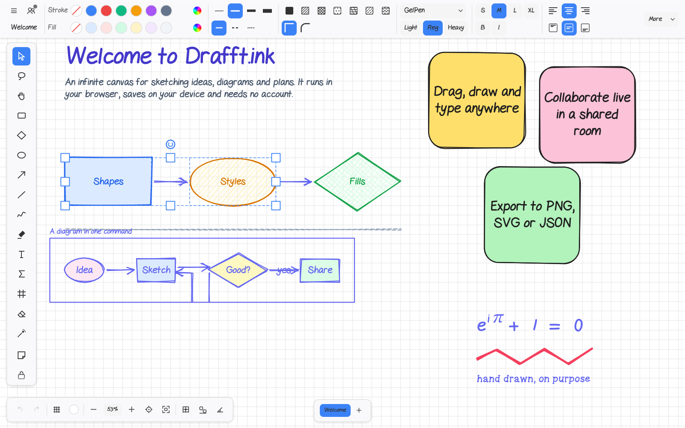

# Drafft.ink


**Seven red lines, all strictly perpendicular, some in green ink? We have a whiteboard for that.**

Three ways in:

- **Try it now** at [drafft.ink](https://drafft.ink/). No account. We'd have to store your password, and we can't even remember our own.
- **Run the full app** on your desktop or your own server, and script it or hand it to an AI agent.
- **Embed just the canvas** in your own web app with the `drafftink-canvas` package, and build something we didn't think of.

<br clear="left"/>



It runs in the browser, on Linux, Windows and macOS, on tablets and on phones.

## What it does

- **Infinite canvas.** Room for every idea, and plenty of space to push the hard problem far to the right.
- **Arrows that stay attached.** Move the box, the arrow follows. Finally, something in your org that stays connected.
- **Draw together.** Watch your colleagues draw boxes around things that don't need boxes, in real time. Edits merge even after someone was offline.
- **Sketch style.** It looks hand-drawn, so nobody can tell if it's the draft or the final. Neither can you.
- **Groups and frames.** Group, ungroup, regroup. Basically agile.
- **Smart guides.** Shapes snap into line and to equal gaps while you drag.
- **Laser pointer.** For pointing at the box everyone is already looking at.
- **Eraser.** For the box someone drew around your box.
- **Text and math.** Hand-drawn and clean fonts, colours per letter, and LaTeX like $e^{i\pi} + 1 = 0$ inside your text.
- **Images and library.** Drop in pictures. Keep the shapes you draw again and again, and import Excalidraw libraries.
- **Open files.** Plain JSON, Excalidraw files in and out, Mermaid in, PNG and SVG out. A PNG export carries the drawing inside. "Can you send me the source file?" You already did.
- **Fingers and pens.** Draw unnecessary boxes with your finger, from the sofa. Works on iPad, tablets and phones. Two fingers pan and zoom, and a resting palm does not draw.
- **Light and dark.** Dark mode changes the canvas too, and the colour buttons show what you will actually get.
- **Fast.** Handles 100,000 shapes. Your diagram has 12, but it's nice to know.
- **No tracking.** We don't know what you draw, and frankly, we don't want to.

## Made to be scripted

Everything you can click is a named command, like `element.create`, `diagram.create` or `arrange.align`. The buttons, shortcuts, menus, the command palette (`Ctrl+/`), scripts, AI agents and the tests all use the same commands. When a command can't run, it says why in plain words, so a script or an agent knows what to fix instead of guessing.

That makes Drafft.ink easy to drive from code and from AI agents. Your AI can draw here too. It can also draw too many boxes.

**Give your AI agent a whiteboard (MCP).**

```sh
cargo build --release -p drafftink-mcp
claude mcp add drafftink -- target/release/drafftink-mcp            # its own document, no window
claude mcp add drafftink -- target/release/drafftink-mcp --attach   # the desktop app you have open
claude mcp add drafftink -- target/release/drafftink-mcp --relay    # the browser tab you have open
```

An agent can build a whole flowchart with one `diagram.create` call, read the drawing back as an outline, and move, style or export anything. Everything listens only on your own machine and needs a fresh token each launch. See [docs/agents.md](docs/agents.md).

**Or script it from the command line.** No window needed.

```sh
drafftink-cli convert diagram.mmd diagram.drafftink                  # Mermaid in, drawing out
drafftink-cli run script.jsonl --doc in.drafftink --out out.svg      # one command per line
drafftink-cli commands --family diagram                               # what is there
```

For apps of your own, the canvas is also a library: panning, zooming, hit testing and dragging, like [Konva](https://konvajs.org/), but on the GPU. The editor (arrows, groups, frames, undo, collaboration) sits on top of it.

## Get it running

**In the browser.** Go to [drafft.ink](https://drafft.ink/). That was it.

**On your computer.** You need [Rust](https://rustup.rs/).

```sh
git clone https://github.com/PatWie/drafft-ink.git && cd drafft-ink
cargo run --release -p drafftink
```

**Your own web version.**

```sh
scripts/build-web.sh          # builds into dist/
scripts/serve-web.sh 8080     # then open http://127.0.0.1:8080
```

**Your own collaboration server.**

```sh
cargo run --release -p drafftink-server -- --web-dir dist
```

One binary, no config file. Nowhere to put a typo. Rooms are stored on disk, or in SQLite or S3 if you ask. See [docs/server.md](docs/server.md).

## Contributing

Issues and pull requests are welcome. Read [AGENTS.md](AGENTS.md) first and run `cargo xtask ci` before you send a change.

## Licence

**AGPL-3.0.** Use it, change it, host it, keep it open. If you host a changed copy, share your changes too. The app links to its source in the About dialog. The bundled fonts have their own terms, listed in [ATTRIBUTION.md](ATTRIBUTION.md).
