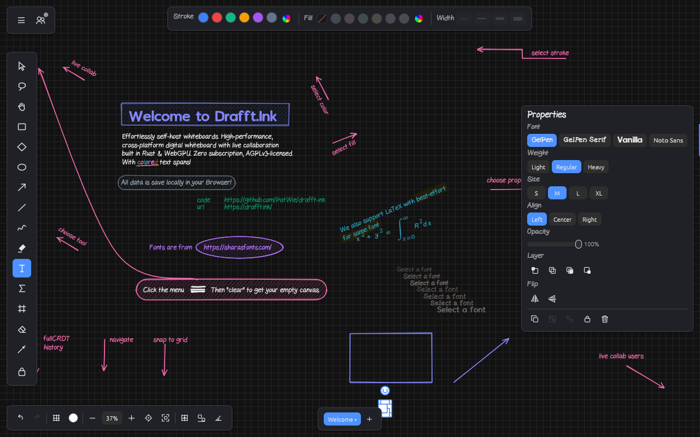

# Drafft.ink


**An infinite canvas whiteboard in Rust, on WebGPU.** Try it in the browser: [drafft.ink](https://drafft.ink/). No account.

Drafft.ink is three things in one workspace: a reusable **canvas library** (viewport, hit testing, transformer, gestures, events), an **Excalidraw-class editor engine** on top of it (bound arrows, groups, frames, bound text, undo, collaboration), and the **app** (desktop and web) that wires the editor to a UI. Real-time collaboration uses the Loro CRDT. A self-hosted server is one binary.

<br clear="left"/>



## Features

- **Shapes and drawing.** Rectangle, ellipse, diamond, line, arrow (sharp, round, elbow), freehand with pressure, eraser, laser pointer, lasso, sticky notes, frames.
- **Arrows that stay attached.** Bound arrows follow their shapes through move, resize, rotate, flip, delete and undo. Bound text in shapes and on arrows.
- **Groups and frames.** Nested groups with enter and exit, frames that clip, lock, z-order, align and distribute, flip, convert between shapes.
- **Text.** Three bundled hand-drawn families (GelPen, GelPen Serif, Vanilla Extract) and Noto Sans, per-character colour, inline LaTeX.
- **Sketch style.** Hand-drawn outlines and fills (roughr), seeded so every peer and every export looks the same.
- **Smart guides.** Alignment, equal spacing, angle and grid snapping.
- **Images.** Drop, paste or insert; they are stored in the document.
- **Formats.** Native `.drafftink` (JSON, versioned), the documents of the first drafft.ink version, `.excalidraw` and `.excalidrawlib`, Mermaid (flowchart with subgraphs drawn as boxes, and sequence diagrams) in, SVG and PNG out. A PNG can carry the scene and be opened again.
- **Collaboration.** Rooms over WebSocket, presence and laser pointers, undo that never reverts a collaborator's edit, offline edits that merge on reconnect. Rooms are stored on disk, in SQLite or in S3.
- **Agents.** The whole editor is also a tool set for AI agents over MCP, and a headless command line.
- **No telemetry.**

What Excalidraw has that this does not (embeddables, image crop UI, bucket fill, eyedropper, and a few more) is listed with the reason in [docs/deviations.md](docs/deviations.md). The row-by-row comparison with the first version and with Excalidraw is [docs/parity.md](docs/parity.md).

## Quick start

You need Rust (the toolchain is pinned in `rust-toolchain.toml`) and a C linker. The desktop app needs a Vulkan, Metal or DirectX 12 GPU; the web build needs a browser with WebGPU.

**Desktop**

```sh
git clone https://github.com/PatWie/drafft-ink.git && cd drafft-ink
cargo run --release -p drafftink                  # or: scripts/run-native.sh
cargo run --release -p drafftink -- my.drafftink  # open a file
```

**Web**

```sh
rustup target add wasm32-unknown-unknown          # and the wasm-bindgen CLI, see docs/building.md
scripts/build-web.sh                              # writes dist/
cargo run --release -p drafftink-server -- --web-dir dist     # http://127.0.0.1:3030
```

**Collaboration server.** `drafftink-server` serves the web build, the WebSocket (`/ws`) and `/health`. It binds `127.0.0.1` unless you pass `--bind`. Rooms live on disk by default; `--storage sqlite` and `--storage s3` are cargo features (`--features sqlite,s3`) that the release packages include. See [docs/server.md](docs/server.md).

**MCP, for AI agents.** Every command of the editor is a tool.

```sh
cargo build --release -p drafftink-mcp
claude mcp add drafftink -- target/release/drafftink-mcp            # headless, its own document
claude mcp add drafftink -- target/release/drafftink-mcp --attach   # the running desktop app
claude mcp add drafftink -- target/release/drafftink-mcp --relay    # the open browser tab
```

The desktop app can also serve MCP over HTTP (`drafftink --mcp-http`). Everything listens on `127.0.0.1` only and needs a per-launch token. See [docs/agents.md](docs/agents.md).

**Command line.** `drafftink-cli` runs the same commands without a window.

```sh
cargo run --release -p drafftink-cli -- convert diagram.mmd diagram.drafftink
cargo run --release -p drafftink-cli -- outline diagram.drafftink
cargo run --release -p drafftink-cli -- run script.jsonl --doc in.drafftink --out out.svg
cargo run --release -p drafftink-cli -- commands --family diagram
```

It converts between the native, first-version, Excalidraw and Mermaid inputs and the native, Excalidraw and SVG outputs. **PNG needs a GPU, which the command line does not have**, so it says so and stops; export PNG from the app. See [docs/cli.md](docs/cli.md).

## Architecture

```
apps/        drafftink (desktop), drafftink-web, drafftink-server, drafftink-mcp, drafftink-cli, drafftink-canvas-js
crates/      the libraries, in layers
xtask/       the gates: cargo xtask ci
```

A crate may depend only on crates of lower layers; `cargo xtask layers` enforces it, and everything below L6 also builds for `wasm32-unknown-unknown`.

| Layer | Crates | Role |
|---|---|---|
| L0 | `geom`, `profile`, `protocol` | math and spatial index, span profiler and counters, collaboration wire types |
| L1 | `scene`, `typeset`, `sketch` | the element model, text and math layout, hand-drawn paths |
| L2 | `render` | Vello scene encoding with caches and culling |
| L3 | `canvas`, `doc` | the Konva-like canvas library; the Loro-backed document store |
| L4 | `edit`, `io`, `collab` | domain rules (binding, routing, groups, layout), file formats, sync client |
| L5 | `engine` | the command registry, `Session`, refusals, gestures, ports |
| L6 | `gpu`, `ui`, `bridge` | wgpu and compositing, the egui UI, the agent bridge |
| L7 | `testkit`, `app` | the test harness; the application glue shared by desktop and web |
| L8 | `apps/*` | the binaries |

**Commands first.** Everything a user can do is a command in the registry: a stable `family.verb` id, an argument schema, an availability check that returns ok or a refusal in plain words, and the function. Buttons, shortcuts, menus, the palette, scripts, MCP and tests all call `Session::execute` or `execute_batch`. A refusal is a value that says how to go on, never a panic. The only exceptions are high-frequency gestures such as a pointer drag; each is listed with its reason in [docs/exceptions.md](docs/exceptions.md), and its end state is reachable as a command. The design is in [docs/plan.md](docs/plan.md), the layering in [docs/architecture.md](docs/architecture.md), the command catalog in [docs/commands.md](docs/commands.md).

## Testing and gates

```sh
cargo xtask ci          # fmt, standards, layers, clippy, wasm, deny, test, perf, size, fixtures, harness
cargo xtask e2e         # browser (Playwright) and native end-to-end suites; needs a display and a GPU
cargo xtask perf --app native    # the real app with real input; needs a GPU
```

`cargo xtask ci` is the gate before every commit. Beyond unit tests, the suite has a scenario for every command (JSON files run by the test kit), a test that sends hostile arguments to every command, fixtures written by the first version of the app and checked against the rewrite, and work-counter tests that fail when a pan, a drag or a hover starts to depend on the size of the scene. The rules are in [AGENTS.md](AGENTS.md) and [docs/testing.md](docs/testing.md). No test is weakened to get green, and the repository allows no `unwrap`, `expect`, `panic!` or `unsafe` outside tests.

## Performance

Measured on one machine (Ubuntu, 64 cores, NVIDIA L40S under Xvfb), the first version of the app against this one. Details, method and the web numbers are in [docs/performance.md](docs/performance.md) and [docs/audit/regression.md](docs/audit/regression.md).

| | First version | Now |
|---|---|---|
| Native idle CPU | 0.3 to 0.6% | 0.5%, 0 frames drawn |
| Native hover over an unchanged canvas, 125 moves/s | 53 to 68% CPU | 6.6% at 10k elements (the X11 present call is most of it) |
| Native pan, 10k / 100k elements | not measured; a frame grew with the scene | frame p99 8.4 / 13.0 ms; the same work at every size |
| Hit test, 10k / 100k elements | 0.70 ms / 9.1 ms | 0.27 us / 0.21 us |
| A local edit in a collaboration room, 10k | 427 ms | 12.6 us |
| One remote update | 103 us to 2 s (rebuild) | 49 us |
| Wasm module, brotli | 3.46 MB | 3.26 MB, plus fonts loaded on demand |
| Native binary | 24.4 MB | 41 MB shipped (`--profile dist`), 47 MB `release` |

The new version is larger on disk (the module is 21% bigger before compression, the native binary 1.7 times): it carries the whole editor, the MCP door and the server stores. Sizes are budgeted in `perf/budgets.json` (`cargo xtask size`, `cargo xtask size --native`).

## Fonts

The fonts are separate works and keep their own terms; the AGPL does not cover them. Noto Sans (SIL OFL) and STIX Two Math are redistributable. **GelPen, GelPen Serif and Vanilla Extract are free to use, but their author has not written down permission to redistribute them**; that is an open item in [ATTRIBUTION.md](ATTRIBUTION.md). If you ship a build, check it.

## Contributing

Issues and pull requests are welcome. Read [AGENTS.md](AGENTS.md) first, and run `cargo xtask ci` before you send a change.

## Licence

**AGPL-3.0-only.** Use it, modify it, host it, and keep it open, including for a modified copy that you offer over a network. Third-party code that was ported (Excalidraw, MIT, and others) is listed in [ATTRIBUTION.md](ATTRIBUTION.md).
