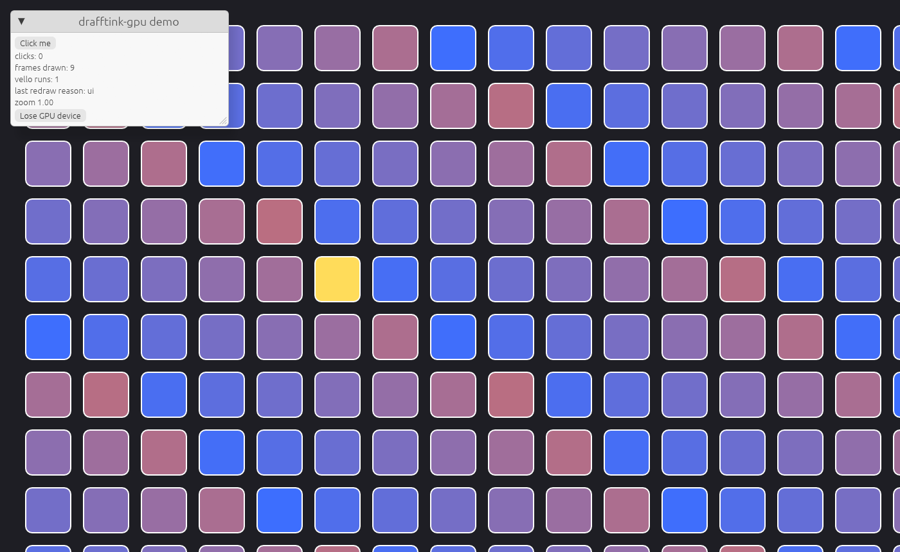

# Shell: `drafftink-gpu`

`drafftink-gpu` (L6) owns the drawing back ends and the window shell. One shell
serves native (Linux X11 and Wayland, Windows, macOS) and the web (wasm32, WebGPU, or WebGL2 where there is no WebGPU).
The shell talks to a `Backend` (`backend.rs`): the Vello + wgpu compositor, or the WebGL2 one (`gl/`, Cargo feature `webgl`;
`docs/web-app.md`, "Browsers without WebGPU"). There is no
`eframe` (docs/deviations.md D1). Its only workspace dependency is `drafftink-profile` (L0), for
redraw reasons and frame stats.

```
crates/gpu/src/
  backend.rs     trait Backend (what the shell needs from a renderer), BackendKind, Detail
  wgpu_backend.rs  the Vello + wgpu back end (feature `wgpu`)
  gl/            the WebGL2 back end (feature `webgl`): replay.rs (Vello scene -> calls), canvas, renderer, backend, offscreen
  settle.rs      reduced detail while moving, and the frame that finishes it (WebGL2 only)
  error.rs       GpuError, LostInfo       frame.rs  EguiFrame, Image
  gpu.rs         Gpu (instance, adapter, device, queue, GpuInfo, lost-device flag), PresentSurface
  compositor.rs  Compositor: Vello into a reused texture, blit + egui in one pass; offscreen -> Image
  blit.wgsl      the 1:1 copy of the Vello texture
  shell.rs       run(app, Options): winit ApplicationHandler, egui pass, frame, recovery
  repaint.rs     RepaintState (pending frame, deadline, hidden), pointer routing rules. No window needed
  app.rs         ShellApp, SetupCx / EventCx / FrameCx, FrameOutput, Waker
  events.rs      ShellEvent, PointerSample, ClipboardContent, DroppedFile, TextInput, Repaint
  host.rs        HostEvent / HostSink: what a platform host sends to the shell
  native.rs      arboard clipboard, PNG, dropped-file reader, cursor map      (not wasm)
  web/           DOM glue: canvas, text agent, clipboard, files, pointer, keys, error page  (wasm only)
crates/gpu/examples/  demo.rs (native), demo_web.rs (web), common/demo_app.rs (the shared app)
crates/gpu/scripts/   idle_native.py, idle_web.py, build_web_demo.sh, web_host_test.py
crates/gpu/tests/     compositor.rs (headless GPU tests)
```

## 1. The contract with the app

```rust
trait ShellApp {
    fn setup(&mut self, cx: &mut SetupCx);                        // new egui Context (also after a GPU loss)
    fn event(&mut self, cx: &mut EventCx, e: ShellEvent) -> (Repaint, Handled);
    fn frame(&mut self, ui: &mut egui::Ui, cx: &mut FrameCx) -> FrameOutput;
}
drafftink_gpu::run(app, Options { title, initial_size, canvas_id })   // native blocks; web returns at once
```

- `event` gets everything that is not an egui widget event: `Pointer` (every move, hover included, with
  pressure, tilt, coalesced points and time stamp), `Paste`, `CopyRequested`, `FilesDropped`, `FileHover`,
  `TextInput` (IME for a non-egui editor), `Visibility`, `Focus`, `GpuRecreated`, `Wake(reason)`.
  The answer is `Repaint::Idle | Now(reason) | After(duration, reason)`. A hover that changes nothing answers `Idle`.
- `frame` builds the egui UI into `ui` and, when the canvas changed, a Vello scene through
  `cx.scene_mut(base_color)`. Not calling `scene_mut` means "canvas unchanged": the shell composites the
  texture of the last Vello run and runs no Vello. The shell keeps the last scene, so a resize or a
  recreated device re-renders it without the app.
- `FrameOutput` says `canvas_rect` (where hover goes to the app), `text_input` (caret rect for the IME and
  the soft keyboard), `cursor`, and `repaint`. An event that opens the text editor also calls
  `EventCx::set_text_input(caret)`: the shell turns the input on in that event, not in the next frame, so a key that
  arrives right after the click reaches the editor (on the web, the hidden textarea has focus by then).
- `Waker` (`Clone + Send + Sync`, from `SetupCx`/`EventCx`/`FrameCx`) wakes the loop from any thread or
  task: `waker.wake(RedrawReason::Collab)`. The loop calls `event(Wake(reason))` and draws a frame if the app answers with a repaint request (a wake that changed nothing visible can answer `Idle`).
  Network messages, finished autosaves and image decodes use this. Timers use `Repaint::After`; when a deadline asked with reason `Collab` arrives, the loop sends `event(Wake(Collab))` and draws only if the app answers with a repaint (every other deadline becomes a frame at once).
- `EventCx::set_clipboard(ClipboardContent)` writes text, PNG images and an app-private payload.
  `open_url`, `set_cursor` are there too. `debug_lose_device` is a test hook.

## 2. Repaint rules

The loop sleeps in `ControlFlow::Wait`, or `WaitUntil(deadline)` when something asked for a delayed frame.
`Window::request_redraw` is called only through `RepaintState`, and every request goes through
`drafftink_profile::redraw(reason)`.

1. A frame is drawn only for a recorded reason. A `RedrawRequested` nobody asked for (the OS exposed the
   window) is recorded as `surface`.
2. Hover over the canvas (no button, egui not using the pointer, position inside `canvas_rect`, no floating
   egui area under it, and the pointer was not over egui last frame) goes to the app and is **held back from
   egui**. The app answers. Why: egui asks for one follow-up pass after every pass that saw input, and the
   next pass sees the next move, so delivering hover moves to egui keeps the loop running as long as the
   pointer moves. Measured before the fix: a single hover change started a run of 10 to 80 frames.
   The held `CursorMoved` is delivered to egui before the next click, wheel, touch or file event that needs a
   position. Consecutive `PointerMoved` events in egui's queue are collapsed, so nothing piles up while idle.
3. A click or touch always gets a frame (popups close, text fields lose focus). A move over an egui area or
   during an egui drag gets a frame (reason `gesture`). Wheel, trackpad scroll and pinch over the canvas go to
   the app first (`ShellEvent::Wheel`); when the app answers `Handled::Yes` egui never sees them, so the
   scroll costs one frame (reason `gesture`) and not the two or three that egui's smoothing asks for. Over an
   egui area, or when the app answers `Handled::No` (a modal is open, the text editor has focus), egui gets the events as before.
4. egui's own requests are honoured: delay 0 is a frame (`ui`), a delay is a deadline (`timer`). This includes
   the follow-up pass after a click and egui's wheel smoothing over an egui area. The
   panel fade-in of a new `egui::Window` costs 50 to 90 frames once after start and after a GPU recovery.
5. Native frames are paced: two frames start at least 0.9 refresh periods apart (60 Hz when the monitor does not
   say). Input that arrives faster (a 125 Hz mouse, a pen) is drawn once per interval; a frame that is due early
   waits for its deadline (`RepaintState::set_min_interval`). The app has already applied every event to the
   camera or the gesture, so nothing is lost, only drawn later by up to one interval. A frame after a quiet time is not
   delayed. The browser paces with `requestAnimationFrame`.
6. `After(d, reason)` becomes `WaitUntil`. The earliest deadline wins. A deadline far in the future is ignored
   rather than overflowing. The deadline carries its own reason, which is recorded when it fires.
7. A hidden window or tab (`Occluded`, `visibilitychange`) draws nothing. Requests stay pending and draw one
   frame when it becomes visible again. Timers keep running but add no frames. Work does not wait for a frame:
   a `Wake` (a bridge or page request, a finished background job) makes the app run its queues at once
   (`App::wake_work`: the inbox and the bridge), so `window.drafftink` and WebMCP calls are answered while the
   tab is hidden or the window is minimized. Nothing is drawn for them; the test is `e2e/web/specs/shell/hidden.spec.ts`.
8. A frame that cannot be presented (surface outdated or lost) reconfigures the surface and asks again with
   reason `surface`. The egui texture updates of that frame are kept and applied with the next one.

`drafftink_gpu::frames_drawn()` and `vello_runs()` are process counters for tests; each drawn frame also logs
`drafftink_gpu::frame` at debug level with its reason.

## 3. Frame

1. `RedrawRequested`: take the reason, check visibility, lost device, size. `begin_frame`.
2. `Context::run_ui` with `app.frame`. egui output: clipboard commands and `OpenUrl` are handled by the shell,
   the rest by egui-winit (cursor, IME, X11 primary selection).
3. If the app called `scene_mut`: `Compositor::render_scene` (Vello, area AA only, into the reused texture).
4. `get_current_texture`, `Compositor::composite`: one render pass that blits the Vello texture and draws egui
   over it, **one `queue.submit`**, then present. `end_frame`.

Vello 0.11 submits its own command buffers inside `render_to_texture`, so a frame with a new scene makes two
submits (Vello's, then the composite) and a frame without one makes exactly one (tested). The scene texture is
allocated once and again only when the size changes (tested: 30 frames, 1 allocation). The old app allocated
a texture per frame.

## 4. Offscreen

`Compositor::render_to_image(gpu, size, Some((&scene, base)), Some(&mut egui_frame)).await` returns an
`Image { width, height, rgba }` (tight rows, top first), also on the web where the buffer map cannot block.
`render_to_image_blocking` is the native wrapper. Use it for PNG export, pixel probes and tests. A `None` scene
reuses the last Vello texture. `Gpu::headless_blocking` creates a device without a window.
`GpuInfo` (`name`, `vendor()`, `backend`, `kind`, `is_software()`) tells an NVIDIA card from llvmpipe or
SwiftShader. Browsers hide the adapter name: on the web it is blank and `kind` is `Other`.

## 5. GPU setup and loss

- Backends: WebGPU only on the web (no `webgl` feature). Native: `PRIMARY` (Vulkan, Metal, DX12) or `WGPU_BACKEND`.
  **No GL**: Vello needs compute shaders, and a GL adapter sorted first made device creation fail on a machine
  with NVIDIA and only the lavapipe ICD. This drops `gles` from the feature list in docs/stack.md §1.
- wgpu panics on uncaptured errors by default. The device installs a handler that logs them.
- A lost device (driver reset, `destroy()`) sets a flag through `set_device_lost_callback`. The shell checks it
  at the start of every frame, drops its GPU state, creates a new instance, surface and device, a new egui
  `Context` (egui's textures lived on the old device), calls `setup` again and then sends `GpuRecreated`.
  The app drops its own GPU resources on that event. Tested on native (headless test; the demo with a real
  window under Xvfb) and in Chromium.

## 6. Platforms

| | native | web |
|---|---|---|
| window | winit 0.30.13 | canvas by id, CSS sizes it; winit's resize observer and DPR handling; `canvas.width/height` come from `surface.configure` |
| pointer input | winit events; `PointerSample` built from them | DOM pointer events on the canvas (all pointer types, capture, coalesced points); winit's events still drive egui |
| pressure | see below | `PointerEvent.pressure` for pen and touch; tilt for pen |
| keyboard | winit | winit on the canvas; the hidden textarea takes over while text input is requested |
| IME / soft keyboard | winit `Ime` events (egui-winit for egui, the shell for `TextInput`) | hidden `<textarea>`: composition, input, key events converted to `egui::Event::Key` |
| clipboard | arboard: text and images (PNG in and out). The shell reads it on Ctrl/Cmd+V and Shift+Insert; `custom` payload is kept in memory next to the text | DOM `paste`/`copy`/`cut` events; async Clipboard API for writes and `read_clipboard`; custom type `web application/x-drafftink` with fallback |
| file drop | winit `DroppedFile`, read on a worker thread (256 MB cap); one event per file | `drop` event, files read fully, mime from the browser |
| hidden | `Occluded` | `visibilitychange` |
| links | egui-winit (`webbrowser`) | `window.open` for http, https and mailto only |
| no GPU | error returned from `run` | self-contained error page, `show_error_page` |

**One path for copy, cut and paste.** Both platforms turn Ctrl/Cmd+C, X and V into `ShellEvent::CopyRequested` and `ShellEvent::Paste`, because only the event carries the system clipboard. The app runs `clipboard.copy`, `clipboard.cut` and `clipboard.paste` from those events (Ctrl+Shift+V adds `plain_text`, read from `EventCx::modifiers`). The keymap must not run them again: the app passes `FrameInput::host_clipboard`, and the keymap skips the bindings that carry `Binding::host_clipboard`. On the web a middle-button press is a pan: `pointer.rs` cancels its `mousedown` and `mouseup`, or Linux browsers paste the primary selection.

**Pen pressure on native** (from winit 0.30.13 sources; not tested on hardware here): Windows reports touch and
pen force from `WM_POINTER` as `Touch.force`; iOS and Android report force; macOS reports only trackpad
pressure (`TouchpadPressure`, not forwarded); X11 and Wayland give no pen pressure through winit (no
XInput2 tablet or `tablet-v2` support). winit has no pointer type, so a native touch is `PointerKind::Touch`,
and `Pen` only for a calibrated force with an altitude angle (Apple Pencil). Real pen pressure on Linux and macOS needs
a platform backend of our own. The web has full pressure, tilt and coalesced samples.

Key policy on the web: `winit` runs with `prevent_default(false)` so `paste` and F5 work; the host cancels what the
app wants (Tab, arrows, Space, Ctrl+S/O/P/A/D/Z, page zoom, ctrl+wheel, Safari gestures) and leaves C/V/X, F5, F11,
F12, Ctrl+R and the devtools chords alone.

## 7. Tests: what runs where

| Check | Where | Command |
|---|---|---|
| Repaint state, coalescing, clipboard cache, PNG, GpuInfo, events | unit tests, any machine | `cargo test -p drafftink-gpu` |
| Compositor: pixels, egui over scene, BGRA, row padding, one submit, no per-frame allocation, device loss and recovery | needs an adapter; `VK_ICD_FILENAMES=/usr/share/vulkan/icd.d/lvp_icd.json` for Mesa lavapipe. Both NVIDIA and lavapipe pass. Never skips | `cargo test -p drafftink-gpu --test compositor` |
| Native idle, hover, pan, wheel, device loss with a real window | Xvfb + XTEST, NVIDIA Vulkan | `~/.venvs/perf/bin/python crates/gpu/scripts/idle_native.py <demo binary>` |
| Web idle, hover, pan, wheel, timer, hidden tab, device loss | headed Chromium on Xvfb, WebGPU on NVIDIA via ANGLE/Vulkan | `crates/gpu/scripts/build_web_demo.sh release` then `.../idle_web.py` |
| Web host: pointer, pen, touch, IME, clipboard, drop, key policy, error page | headless Chromium, no WebGPU needed | `.../web_host_test.py` |

Results (2026-11-07, NVIDIA L40S, 64 threads, Xvfb; native release build; web `release` profile build, Chromium 1208):

| window | native | web (all Chromium processes) |
|---|---|---|
| idle 10 s | 0 frames, 0.3 % of a core | 0 frames, 0.6-0.9 % (blank page 1-2 %) |
| hover over empty canvas, 125 moves/s, 10 s | 0 frames, 0.8 % | 0 frames, 9 % |
| hover across shapes | 1 frame per hover change (55 for 55) | same |
| drag-pan 125 moves/s | 1 frame per move, 53-60 % | about 50 fps, 103-107 % (GPU process bound under Xvfb) |
| wheel 100 ticks/s | about 3 frames per tick (egui smoothing), 65-90 % | 223 frames, 108 % |
| idle after pan, wheel, recovery | 0 frames | 0 frames |
| GPU device destroyed with F9 | recovers, draws, then 0 frames idle | same |
| `After(100 ms)` timer, 10 s | | 99 frames, 0 Vello runs, 17 % |
| tab hidden with the timer on | | 0 frames; 10 fps again when visible |

The hidden-tab check fires `visibilitychange` with `document.hidden` overridden, because Xvfb has no window
manager and Chromium keeps both tabs visible. It tests our listener, not the browser's signal.



## 8. Remaining gaps

- Vello does not accept an encoder, so a frame with a new scene makes two submits. A fork or a later Vello release could fix it.
- Winit gives no pen pressure on Linux and macOS (section 6). Windows pen and iOS force are unverified.
- Not tested on real hardware or browsers: Windows, macOS, Wayland (compiled only), Safari, Firefox, a real OS IME,
  soft keyboards, hi-dpi web (DPR 2 with a matching device-pixel box), pinch on touch screens.
- The post-click pass costs an extra frame (section 2, rule 4), and egui's wheel smoothing still applies to a wheel over an egui area.
- `Waker::exit` closes the window from another thread (the scenario runner uses it).
- Reserved shortcuts on the web are a fixed list in `web/keys.rs`. The app cannot yet say which ones it owns.
- The web clipboard write of images and custom payloads is async only and may fail under Safari's gesture rule.
  Browsers that skip the `copy` event for an empty selection give no `CopyRequested`.
- A second mouse button pressed while another is held gives no Down or Up on the web.
- Dropped files arrive as one event per file on native.
- The WebGL2 back end does not recover from a lost context (the shell tries to make a new back end, which fails while the context is lost, and shows the error page).
- `cargo clippy -p drafftink-gpu --target wasm32-unknown-unknown` also lints `drafftink-profile`, which fails on
  `crates/profile/src/spans.rs:213` (`unnecessary_literal_unwrap`, wasm-only). Not changed here.
