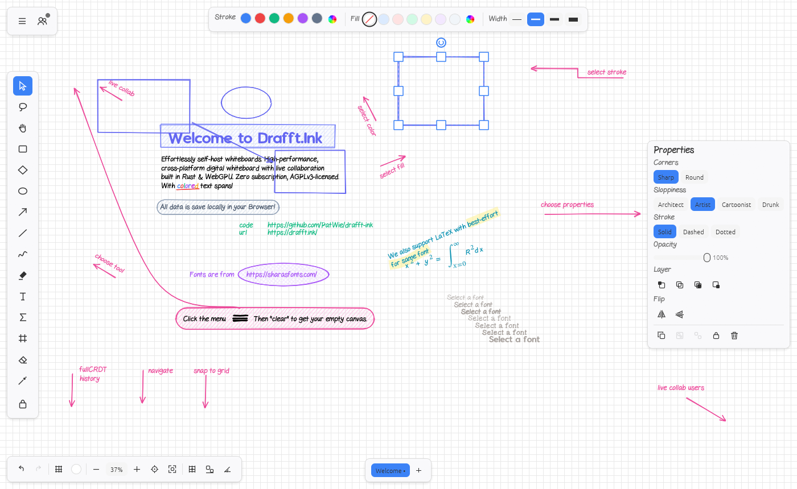

# The web app

The web build is `apps/drafftink-web` (the wasm entry point and the JavaScript API) over `crates/app` (the shared `App`) with the
browser platform in `crates/app/src/web`. `drafftink-server` serves the result and the collaboration socket from one origin, so the
whole deployment is one binary and one folder.

```
apps/drafftink-web/src/   lib.rs  entry.rs (start)  api.rs (window.drafftink)  agent.rs (relay client)
                          pairing.rs (pure rules, tested natively)  js.rs (JSON and promises)
crates/app/src/web/       mod.rs (platform)  storage.rs + idb.rs + cache.rs  files.rs  net.rs  host.rs  rng.rs  pure.rs
web/                      index.html  manifest.webmanifest  sw.js  favicon.svg  icon-*.png
scripts/                  build-web.sh  serve-web.sh  web_check.py
```

## Build and serve

```
scripts/build-web.sh            # release-wasm build -> wasm-bindgen --target web -> wasm-opt -Oz -> fonts -> dist/
scripts/serve-web.sh 3030       # cargo run --release -p drafftink-server -- --web-dir dist --bind 127.0.0.1:3030
```

`build-web.sh` checks that the `wasm-bindgen` CLI has the version pinned in the root `Cargo.toml` (0.2.130), runs `wasm-opt` from
`PATH` or `~/.cargo/tools/binaryen-version_*/bin`, writes `dist/` and prints the wasm size raw, after `wasm-opt`, gzip -9 and
brotli -11. It also writes `.gz` and `.br` next to each text and wasm file; `drafftink-server` serves them when the browser accepts
them (`--no-precompress` skips this, `--profile release` builds faster and bigger). `dist/` is in `.gitignore`.

`wasm-opt` runs with an explicit feature list, not `--all-features`: with binaryen 133 `--all-features` turns on experimental
encodings and Chromium refuses the module (`unknown import kind 0x7e`).

`dist/` holds `index.html`, `manifest.webmanifest`, `sw.js`, the icons, `BUILD` (the build hash), `sizes.json` (the numbers `cargo xtask size`
checks), `pkg/drafftink_web.js` plus `pkg/drafftink_web_bg.wasm`, and `fonts/` (next section). The build hash (12 hex digits of the wasm
and the glue) replaces `__BUILD__` in `index.html` and `sw.js`.

The build uses `-C target-feature=+simd128` (set in the script, not in `.cargo/config.toml`, so the npm package keeps building for plain
WebAssembly): every browser with WebGPU has SIMD, and it makes the CPU glyph rasteriser that egui pulls in 1.7 MiB smaller.

### Fonts are separate files

The big fonts are not in the wasm. `scripts/build-web.sh` copies seven files to `dist/fonts/<name>.<hash>.<ext>` (the hash is of the
content, so a cached copy never goes stale; the server sends them with `Cache-Control: immutable`) and writes the map from plain name to
address into `window.__assets` in `index.html`:

| File | Brotli | Loaded |
|---|---|---|
| `Ubuntu-Light.ttf` (egui's text font) | 137 KB | before the first frame: `index.html` preloads it and `platform()` awaits it. If it fails, GelPen draws the UI text |
| `STIXTwoMath-Regular.otf` (formulas) | 381 KB | preloaded with the module; used right after the first frame because the welcome document has a formula. A formula shows as an error box until the font is in, then draws |
| `Hack-Regular.ttf`, `emoji-icon-font.ttf` (egui's monospace font; arrows, shift and command signs) | 123 KB, 145 KB | after the first frame, in the background |
| `NotoSans-Regular/Bold/Italic.ttf` | 223 KB, 232 KB, 228 KB | when a text needs them: the family `noto_sans`, or a character that no other font has |

The mechanism is `Typesetter::wanted_fonts` / `provide_font` (`drafftink-typeset`: a layout that needs a font says so and the host
supplies it; the desktop build has them built in through the Cargo feature `embedded`, so `wanted_fonts` stays empty), `drafftink_ui::theme::UiFont`
(egui has no `default_fonts` feature on the web) and `HostJob::LoadFont` / `Inbound::FontLoaded` in `crates/app` (`web/assets.rs` fetches).
When a font arrives, the typesetter drops the layouts it made without it, `CanvasView::sync_fonts` drops the render fragments, and the next frame
draws again. `sw.js` precaches the Ubuntu font with the shell and stores the others with the first answer.

Sizes of the full app build (2026-11-08, `release-wasm`, wasm-bindgen 0.2.130, binaryen 133 `-Oz` with the explicit feature list;
MB here are MiB, as in `performance.md`): raw 24.62 MB (wasm-bindgen output), **wasm-opt 11.79 MB**, gzip -9 4.36 MB,
**brotli -11 3.06 MB**, plus 1.44 MB of font files that the page loads when it needs them. Before the size work it was 28.43 / 17.62 / 6.51 / 4.48 MB
with the fonts inside. The old app was 10.33 MB raw and 3.46 MB brotli. What was done, what each step gave and what was left out is
the table in `performance.md`, "Wasm size". `cargo xtask size` checks the numbers against `perf/budgets.json` (it builds the app, so it runs in
`cargo xtask ci` and as its own CI job).

## What the page does

`index.html` has one `<canvas id="canvas">` that fills the viewport (CSS), a loading bar and a failure box. A module script loads
the glue, awaits `start("canvas")` and removes the loading bar after the first frame. Then it sets `window.__started`
(`window.__error` on failure; the check script reads both) and asks the browser for persistent storage. If WebGPU is missing the
shell shows its own error page.

`start(canvas_id)` (in `entry.rs`):

1. installs the panic hook and `console_log`; turns profiling on only for `?perf=1` (or `?perf=overlay`, which also shows the
   overlay) or when the page set `window.__drafftinkPerf = true` before `start`;
2. reads the page address: `?room=..&server=..` (query or fragment) is the room to join, via `StartupLink::parse`;
3. `drafftink_app::web::platform(..)` opens IndexedDB (awaited), then builds the ports and the bridge queue;
4. installs `window.drafftink`, reads or resumes the agent pairing, builds `AppConfig { join, default_server: "/ws",
   stored_default_target: true, .. }` and calls `drafftink_gpu::run`.

### Ports in the browser

| Port | Web implementation |
|---|---|
| Storage | `WebStorage`: the whole `drafftink` IndexedDB (one object store, keys `<namespace>/<key>`) is read into memory before the app starts. `get` and `list` read memory. `put` and `delete` change memory and queue a write that goes out in the next microtask (a burst of writes to one key is one write). Pending writes are flushed again on `pagehide` and when the page becomes hidden. A failed transaction is retried with the next change or flush and logged. Without IndexedDB (some private modes) the storage is memory only and a notice at the bottom of the page says so. Two tabs of one site each see the database as it was when they opened; the autosave record belongs to the tab that wrote last. |
| Files | `Download{name}`: a Blob with the given media type and an anchor click. `Stored{name}`: the `Documents` namespace. Paths and handles are refused with a plain message. |
| Net | `WebTransport`. `same_origin_url("/ws")` is `ws(s)://<location.host>/ws` by the page protocol; plain `ws://` to other machines is allowed only when the page itself is on a loopback host. |
| Clock, ids | `AppClock`; `RandomIds` over `crypto.getRandomValues`. |
| Clipboard | the shared slot the shell fills from `paste` events. |
| Renderer | `WebRenderer` (`crates/app/src/web/render.rs`): PNG export, `clipboard.copy_as` png and `view.screenshot`. See "PNG export" below. |
| Pickers | a hidden `<input type=file>` with accept lists (documents; images, multiple; libraries). The files are read in full and posted as `Inbound::Picked`. Cancel (the input's `cancel` event) sends nothing and removes the input. `PickSaveTarget` answers at once with the download name. `ReadClipboardText` uses `navigator.clipboard.readText()`. |

## PNG export

The engine's `Renderer` port is synchronous, and a browser reads a texture back from the GPU asynchronously. So the port works in two
steps (`web/render.rs`). The first `render_png` for a request composes the scene (the same code as the desktop, `crates/app/src/offscreen.rs`),
starts drawing it on a GPU device of its own and answers `PortError::NotReady`; the command refuses with `render_pending`. When the pixels are
back the port wakes the app. The caller then runs the command again, and the second call (same document, same request) gets the finished PNG.
Nobody sees the refusal in normal use:

- the bridge (`window.drafftink.execute`, the agent relay) parks a request that came back `render_pending` and runs it again on the next
  polls (`BridgeHost`), so the promise resolves with the picture;
- the UI keeps the call in `UiState::waiting`, shows "Drawing the picture..." and runs it again each frame until it works (the export dialog
  stays open until then).

A `batch` with an export step waits the same way: the engine takes the whole batch back and answers it with `pending_render`
(`commands.md` §1.7), the bridge parks it and runs it again, and the second run finds the picture. Finished pictures stay on a
small shelf (4), so a batch with several exports completes after one rerun per picture. Only one picture is drawn at a time; a
second request waits. `scripts/web_check.py --app` exports a PNG, takes a screenshot and exports a second
size, and checks the files.

## `window.drafftink`

Every method returns a Promise except `perf*`, `frames` and `agent.status`. Requests are queued for the app and run between
frames with origin `agent`, exactly like the desktop bridge (`drafftink_bridge::core::dispatch`). A refusal rejects with
`{code: -32010, message, data}`; `data` is the whole refusal (`code`, `command`, `message`, `suggest`, `details`). Bad arguments
reject with `-32602`, a full queue with `-32004`.

```js
const made = await drafftink.execute('element.create', { kind: 'rectangle', bounds: { x: 100, y: 100, w: 240, h: 140 } });
await drafftink.batch(
  [{ id: 'element.create', args: { kind: 'ellipse', bounds: { x: 400, y: 80, w: 120, h: 90 } }, as: 'oval' }],
  { label: 'add an oval', atomic: true });
const { items } = await drafftink.execute('element.query', { fields: ['id', 'kind', 'bounds'] });
await drafftink.commands({ family: 'element' });      // the registry with live availability
await drafftink.describe('element.create');          // schemas, facts, example, refusals
await drafftink.recent({ limit: 10 });                // the ring: what ran, with origin
await drafftink.state();                              // engine.state
try { await drafftink.execute('nope.nothing'); } catch (e) { console.log(e.code, e.message, e.data.suggest); }
```

| Call | Meaning |
|---|---|
| `execute(id, args?)` | one command |
| `batch(steps, opts?)` | `steps: [{id, args?, as?}]`, `opts: {label?, atomic?, dry_run?}` |
| `commands(opts?)`, `describe(id)`, `recent(opts?)`, `state()` | as in docs/agents.md section 5.1 |
| `perf()` | `PerfStats` as an object (counters and redraw reasons are always on; spans and frame times need `?perf=1` or `perf_enable(true)`) |
| `perf_reset()`, `perf_enable(on)` | reset the recorder; turn span recording on or off |
| `frames()` | `{frames, vello_runs}`: frames drawn and frames in which Vello ran since start. Two reads 10 s apart that are equal prove an idle page |
| `version` | the crate version |
| `agent.pair(url, token)` (alias `connect`), `agent.disconnect()`, `agent.status()` | next section |

## Pairing with an AI agent (docs/agents.md, section 5.2)

`drafftink-mcp --relay` prints a link `https://<this site>/#drafftink-agent-port=<port>&drafftink-agent-token=<64 hex>`. When the page
opens with it:

1. at start the page reads the two keys from `location.hash` and removes both with `history.replaceState`, even if the pair is
   unusable, so the token does not stay in the address bar or the history;
2. it builds `ws://127.0.0.1:<port>/` itself and connects. The link cannot name another host;
3. it sends `hello` with `{token, page: {version, registry: {count, digest}}}`; the relay answers with a `resume_token`, which the
   page stores with the port in `sessionStorage` (this tab only);
4. from then on it answers the relay's requests (`execute`, `batch`, `commands`, `describe`, `recent`, `state`, `ping`) through the
   same queue as `window.drafftink.execute`, so they run between frames on the session;
5. when the socket closes with any code except 1008 it reconnects with the resume token after 1, 2, 4, ... 30 s, for 10 minutes.
   A reload resumes from `sessionStorage` the same way. A wrong or used token (error -32001, close 1008) stops everything and the
   status says to ask for a new link. A first pairing that cannot reach the relay rejects with a message and does not retry;
6. `agent.disconnect()` closes with 1000 and forgets the resume token.

By hand: `await drafftink.agent.pair('ws://127.0.0.1:4555/', token)`. Any other host is refused: "The agent bridge only listens on
this machine (loopback). Use an address like ws://127.0.0.1:<port>, ws://localhost:<port> or ws://[::1]:<port>." `agent.status()`
returns `{state: idle | connecting | connected | waiting | refused | gave_up, port, message, attempts}`.

Chrome may ask the user to allow the site to reach local network addresses; Safari blocks `ws://127.0.0.1` from an `https` page.

## Service worker and caching (`web/sw.js`)

| Request | Rule |
|---|---|
| install | stores the shell (`./`, `index.html`, manifest, icons, `pkg/drafftink_web.js?v=<build>`, `pkg/drafftink_web_bg.wasm?v=<build>`) in the cache `drafftink-<build>` |
| activate | deletes every other `drafftink-*` cache and takes control of open pages |
| navigation | network first (`cache: no-cache`); when the network fails, the stored `index.html`. So a deployment shows at once and the app still starts offline. Room links (`/?room=x`) work offline too (the room itself needs the network) |
| other same-origin GET | cache first; a plain 200 that was not stored yet is stored |
| `/ws`, `/health`, other origins, non-GET | never touched |

The script and the wasm carry `?v=<build>` and are looked up with the exact address, so a cached file always belongs to the build
that asked for it. The worker is registered only on `https:` and on `localhost` or `127.0.0.1`.

## Checks

`scripts/web_startup.py` measures the start (navigation to the first frame, cold and with the service worker warm) and the frame time of a
pan over 1000 rectangles (results: `performance.md`, "Wasm size"). Each idle window of `web_check.py` starts after the page has settled
(no network activity and no frame for 1.5 s), because the fonts that load after the first frame are work, not idling.

`scripts/web_check.py [--app] [--shot docs/img/web-app.png]` (python from `~/.venvs/perf`; needs `dist/` and
`target/release/drafftink-server`). It starts the server on an ephemeral port with `--web-dir dist --storage memory`, a private
Xvfb and headed Chromium with the WebGPU flags of docs/shell.md, and checks: the page starts and draws; the API surface; the
pairing refusals; the pairing keys are scrubbed from the address; 0 frames and the CPU of all Chromium processes in a 10 s idle
window. With `--app`: `state`, `commands`, `describe`, a refusal as a rejected promise, two rectangles with an arrow bound to both and `element.move` dragging it along, `commands()` with availability, a batch, the
ring shows origin `agent`, a real mouse drag with the rectangle tool (key `r`) that draws a rectangle (origin `ui`), a screenshot, 0 frames after commands, a PNG export, a screenshot and a second export at another scale (the files are decoded and must not be blank), the workspace in IndexedDB and back after a reload, two pages
(`127.0.0.1` and `localhost`, so separate IndexedDB) in one `?room=` seeing each other's elements, 0 frames in a room alone and
with a peer (22 s windows, which cover the server ping and the presence heartbeat), the service worker active, and a reload with the server stopped still starting the app.

Pure rules (address check, pairing link, backoff, frames, download names, address building, the write cache) have unit tests that
run natively: `cargo test -p drafftink-web` (the files of `crates/app/src/web` that need no browser are compiled into that test
target, because the repository has no wasm test runner).



## Known gaps

- **Wire size.** 3.06 MB brotli for the module and about 0.5 MB of fonts for the first load of the welcome page (see above). After the first
  visit the service worker serves everything from cache. Not done: the command schemas (`schemars`) are in the module.
- **Idle while in a room.** Fixed on 2026-11-08: a wake from the collaboration socket, and a collaboration deadline, go to the
  app first (`ShellEvent::Wake(Collab)`, `docs/shell.md`); it pumps the session and asks for a frame only when the poll left a
  visible change or a notice. Measured: 0 frames in 22 s alone in a room and in 22 s with a peer, after the join has settled.
- **Two tabs.** The IndexedDB is read once per tab; the autosave record belongs to the tab that wrote last.
- **File System Access** (saving to a chosen place) is not used: saving is a download or a stored document.
- **Safari and Firefox** were not tried. The service worker, IndexedDB and pickers use standard APIs; WebGPU support decides.
- **Clipboard read** for the equation editor needs the browser's permission and a user gesture.
- **Screenshots** of the canvas by script (`drafftink.screenshot()`) are not offered: the shell exposes no read-back to the page.
